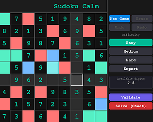

# Sudoku Calm

Classic Sudoku with a twist: every empty cell is colored by how many numbers could still go in it.

Written in Python with [pygame](https://www.pygame.org/). It runs on your desktop and in a web browser through [pygbag](https://pygame-web.github.io/).

**[Play in your browser](https://cloudbv.itch.io/sudoku-classic-with-a-twist)** · **[Project page](https://cloudbv.github.io/Sudoku-Calm/)**



## Features

- **Four difficulty levels:** Easy, Medium, Hard and Expert (30 to 64 cells removed)
- **Unique solutions:** every puzzle has exactly one solution, checked as the generator removes each number
- **Heat map:** empty cells are colored by how many digits could still fit, and red means only one option is left
- **Logic assistant:** select a cell and the sidebar lists the digits that can still go there
- **Highlights:** the selected cell's row and column are highlighted, and every cell with the same number glows gold
- **Instant conflict warning:** an illegal number turns red as soon as you type it, with a notice in the sidebar
- **Validate:** checks your answers and marks wrong cells in red
- **Solve (Cheat):** fills in the whole solution in yellow
- **Undo / Redo:** step back and forward through your moves
- **Numpad support:** numpad 1-9 works for input

## Controls

| Action | How |
| --- | --- |
| Select a cell | Click it, or use the arrow keys |
| Enter a number | `1`-`9` on the top row or the numpad |
| Clear a cell | `Backspace`, `Delete`, numpad `0`, or the Erase button |
| Undo | `Ctrl` + `Z` |
| Redo | `Ctrl` + `Y` |

## Run it locally

You need Python 3 and pygame.

```bash
pip install pygame
python3 sudoku_calm.py
```

## Build the web version

```bash
pip install pygbag
pygbag sudoku_calm.py
```

Then zip the `build/web` folder and upload it to itch.io as an HTML project.

## How it works

- **Generating a puzzle:** a backtracking solver fills an empty board with a random complete solution. Cells are then removed in random order, and a removal is undone if the puzzle would stop having exactly one solution.
- **The heat map:** for each empty cell, the game collects the numbers already used in its row, column and 3x3 box. The digits left over are the possible ones, and how many there are picks the color. Results are cached, and only the affected row, column and box are recalculated after each move.
- **Running in the browser:** the main loop is async and yields to the browser every frame, as pygbag requires. A loading screen is drawn before each puzzle is generated, so the page never looks frozen.

## Files

| File | What it is |
| --- | --- |
| `sudoku_calm.py` | The whole game: generator, solver, game logic and interface |
| `index.html` | The project page, served by GitHub Pages |
| `screenshot.png` | Screenshot used by the README and the project page |
